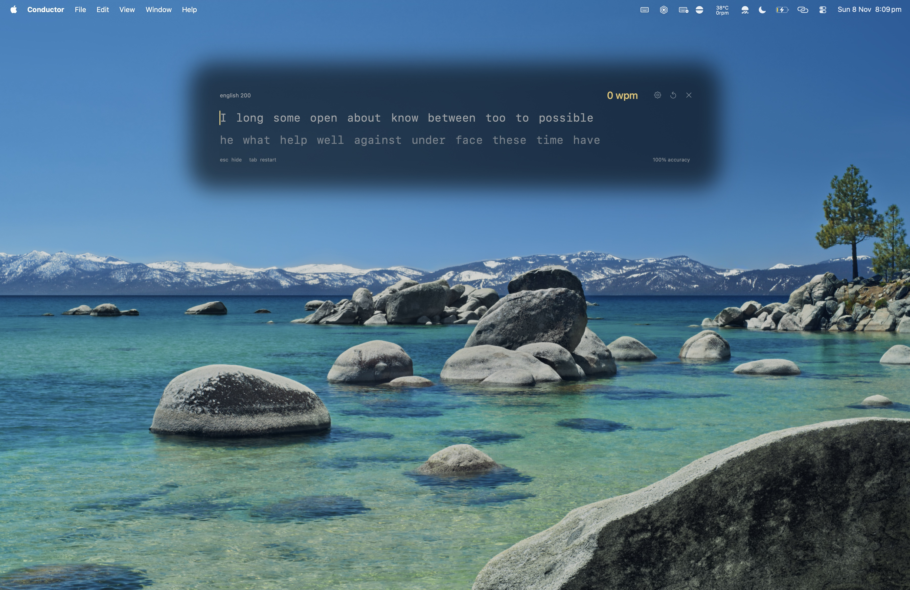
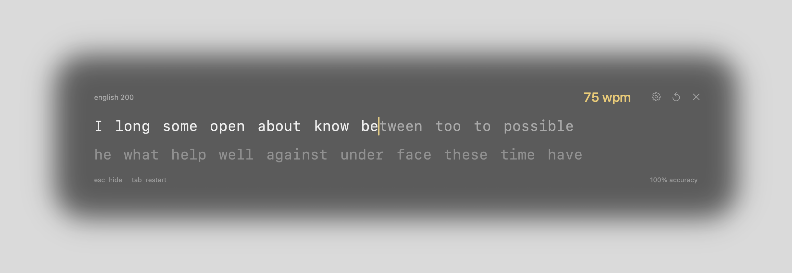

# Typebar

A small typing-practice overlay for macOS. Press and release **Control + Option + Command** to bring up two ten-word lines near the top of your screen, then keep typing for as long as you like. The shortcut can be changed in Settings.

[Download for Mac](https://akwas.vercel.app/downloads/typebar/Typebar-mac.zip) · [Releases](https://github.com/alfonsokkim/typebar/releases) · [akwas](https://akwas.vercel.app)



## What it does

- Uses Monkeytype's English 200 word list, bundled for offline practice. The word “I” accepts both `I` and `i`.
- Replaces each completed ten-word line with another. There is no test timer or finish screen.
- Shows live WPM and accuracy, with theme colours for correct letters, mistakes, and the caret.
- Resets WPM after more than **five seconds without typing**. The next keystroke starts a fresh speed measurement while keeping your words and position.
- Moves the caret with a quick **110 ms** glide, respecting macOS Reduce Motion.
- Sits over other apps on the display containing your pointer, with a translucent dark background and softly fading edges.
- Includes Serika Dark, Serika, Carbon, Dracula, Nord, and Catppuccin palettes from Monkeytype, plus the original Shadow theme and custom colours.
- Lets you adjust size, corner radius, edge blur, transparency, and position, with settings saved between launches.
- Lives in the menu bar under an **a│** icon. Hiding the overlay pauses the clock; quitting clears the session.



The first image is a full-screen capture with the native overlay at its default size over a clean wallpaper background. The second is a close-up rendered by the same native views with sample typing.

## Install

Requires **macOS 14 or later**. The download is a universal app containing Apple Silicon and Intel builds. Runtime checks have been performed on Apple Silicon.

1. [Download Typebar-mac.zip](https://akwas.vercel.app/downloads/typebar/Typebar-mac.zip) and unzip it.
2. Drag **Typebar.app** into **Applications**, then open it.
3. If macOS blocks the first launch, open **System Settings → Privacy & Security**, choose **Open Anyway** for Typebar, and confirm. This build is locally signed and is not notarized by Apple.
4. Enable **Typebar** under **System Settings → Privacy & Security → Accessibility** for modifier-only shortcuts such as the default. Shortcuts containing a regular key use macOS global hotkeys. The menu-bar button also opens the overlay.

To launch it when you sign in, add Typebar under **System Settings → General → Login Items**. It does not enable this automatically.

## Controls

| Key | Action |
| --- | --- |
| **Control + Option + Command**, then release | Show or hide (default, configurable in Settings) |
| **Space** | Move to the next word |
| **Backspace** | Correct a character or return to the previous word in the current line |
| **Option + Backspace** | Clear the current word |
| **Escape** or **Command + W** | Hide and return focus to the previous app |
| **Tab** or **Command + R** | Restart practice |
| **Command + ,** | Open settings |
| **Command + Q** | Quit |

Clicking another app hides and pauses the overlay. Adding another key to the three-modifier shortcut cancels the toggle so existing shortcuts can keep working. Secure Input in another app can prevent modifier-only shortcut detection; use the menu-bar icon in that case.

## Appearance and position

Click the **gear** in the overlay, choose **Settings…** from the a│ menu, or press **Command + ,** while typing.

- **Colours:** choose Shadow or one of six Monkeytype palettes. Choose **Custom** to set the background, typed text, untyped text, caret/WPM, and mistake colours separately.
- **Size:** scale the whole overlay from 60% to 140%, including its text and controls.
- **Corner radius:** choose square corners or increasingly rounded corners, from 0 to 120 points.
- **Edge blur:** 0 gives a hard edge with no diffusion. Increase it up to 60 points for a wide, soft fade. This softens the overlay's edges rather than blurring the words.
- **Opacity:** adjust **Background opacity** and **Text opacity** independently, from 0% to 100%. Text opacity includes the words, caret, WPM, and overlay controls.
- **Position:** choose one of nine placements, or use the horizontal and vertical sliders. Placement is relative to the display under your pointer when you open the overlay.

Settings open centred in the space between the overlay and the bottom of the display, with the actual overlay staying visible at its configured position. Changes update it immediately while the typing clock is paused. Settings save automatically on this Mac. **Done** closes settings and returns keyboard focus to the overlay without clearing your practice. **Reset Defaults** restores Shadow and the original layout. On smaller displays, Typebar reduces the effective size or blur as needed to keep the complete overlay on-screen.

## Change the shortcut

In Settings, click the current shortcut under **Shortcut**, press the combination you want, and release its keys to save it. Escape cancels recording. **Reset** beside the shortcut restores Control + Option + Command.

You can use Control, Option, or Command alone or together, optionally with Shift, or combine them with a regular key. Function keys such as F6 also work. Fn and Globe by themselves are not supported. If macOS cannot register a combination, Typebar keeps the previous shortcut and shows an error.

Modifier-only shortcuts toggle when you release all their modifiers, provided no other key was pressed. Shortcuts with a regular key use macOS's global hotkey registration and toggle once per press. Their registration is suspended while recording a replacement, and restored if recording is cancelled. The menu bar shows your saved shortcut.

## WPM and accuracy

WPM uses five characters per standard word, including spaces. Correct completed words and matching characters in the current word contribute to the calculation. Incorrect completed words do not count. Backspace corrections can reduce the current score.

The clock starts on your first keystroke. Short pauses while the overlay is visible count toward your speed. After more than five seconds idle, speed resets to zero and starts fresh on the next keystroke. Characters typed before that break are excluded from the new measurement. Accuracy covers the whole practice session and is reset with Tab.

## Privacy

Typebar has no accounts, analytics, servers, or runtime network requests. It saves appearance preferences and the chosen shortcut locally, but does not save what you type. The global shortcut monitor checks modifier changes and whether an extra key was pressed during the chord; it does not save or transmit keys typed in other apps. Practice input is handled only while the overlay has keyboard focus. Shortcut recording captures keys only in the focused settings window while the recorder is active.

## Build

Requires Xcode command-line tools with **Swift 6.2 or later**. There are no external package dependencies.

```sh
swift test
./build.sh
open dist/Typebar.app
```

Build a universal release ZIP and its checksum:

```sh
./scripts/package-release.sh
```

The output is `dist/Typebar-mac.zip` and `dist/SHA256SUMS.txt`. Reproduce the close-up images with:

```sh
dist/Typebar.app/Contents/MacOS/Typebar --capture-previews docs
```

For a full-screen image, run `dist/Typebar.app/Contents/MacOS/Typebar --desktop-preview`, then take a macOS screenshot. This temporarily covers the primary display with its wallpaper and the native overlay, keeping open windows and desktop files out of the image. It exits after 60 seconds and does not change the wallpaper or desktop settings.

## License

GPL-3.0. The English word list comes from [Monkeytype](https://github.com/monkeytypegame/monkeytype). The palettes also come from Monkeytype. Their pinned sources are documented in [THIRD_PARTY_NOTICES.md](THIRD_PARTY_NOTICES.md). Typebar is an independent app and is not affiliated with Monkeytype.
